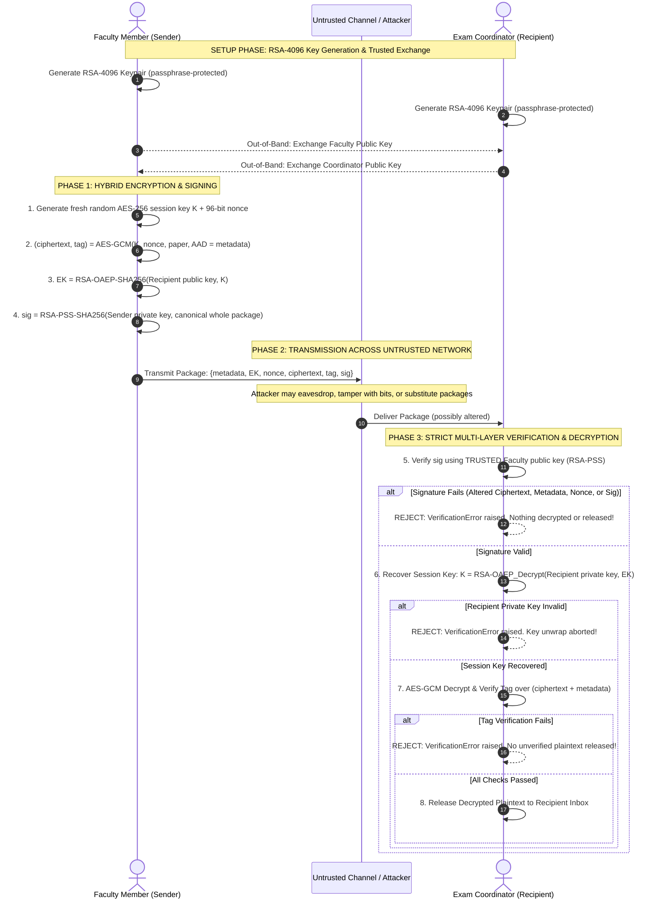

# Comprehensive Cryptography Workshop Report: Secure Examination-Paper Exchange

**Course / Subject:** Cryptography and Network Security  
**Project:** Secure Examination-Paper Exchange Using Python  
**Implementation Package:** `secure_exam/`  
**Core Technologies:** Python 3, `cryptography` library (PyCA)  
**Cryptographic Standards:** NIST SP 800-57, FIPS 186-4 (RSA-PSS), FIPS 197 (AES), NIST SP 800-38D (GCM), RFC 8017 (PKCS#1 v2.2 OAEP & PSS)

---

## 1. Executive Summary & Problem Formulation

An academic institute requires a secure, automated mechanism to transmit high-stakes examination question papers from a faculty author (Sender) to an authorized examination coordinator (Recipient) over an untrusted transmission channel (e.g., campus network or public internet). 

An adversary in the channel possesses the capability to eavesdrop, tamper with question papers, truncate questions, substitute fraudulent packages, or replay prior transmissions.

To counter these threats, this application implements an **Authenticated Hybrid Cryptosystem** combining:
- **AES-256-GCM** for bulk confidentiality and authenticated encryption.
- **RSA-OAEP-SHA256** (with 4096-bit keys) for asymmetric key encapsulation.
- **RSA-PSS-SHA256** (with 4096-bit keys) for non-repudiation and whole-package integrity.
- **RFC 8785 Canonical JSON Serialization** to prevent parsing and serialization malleability.

---

## 2. Cryptographic Primitives & Specifications

| Dimension | Standard & Parameter | Concrete Implementation | Security Rationale |
| :--- | :--- | :--- | :--- |
| **Asymmetric Keys** | RSA 4096 bits ($e = 65537$) | `rsa.generate_private_key(...)` | High security margin (>140-bit symmetric equivalence), protecting confidential examination papers well beyond 2030+. |
| **Private Key Protection** | PKCS#8 with passphrase | `BestAvailableEncryption(passphrase)` & mode `0600` | Protects keys at rest; private keys cannot be stolen without the passphrase. |
| **Symmetric Bulk Cipher** | AES-256 in GCM mode | `AESGCM(session_key)` (256-bit key) | High-throughput hardware-accelerated encryption combined with Galois Field $\text{GF}(2^{128})$ GMAC authentication. |
| **Symmetric Nonce** | 96-bit (12 bytes) CSPRNG | `secrets.token_bytes(12)` | NIST SP 800-38D recommended standard; avoids GHASH pre-processing and guarantees nonce uniqueness. |
| **Key Encapsulation** | RSA-OAEP with SHA-256 | `padding.OAEP(mgf=MGF1(SHA256), hash=SHA256)` | Immune to Bleichenbacher chosen-ciphertext attacks ($\text{IND-CCA2}$ secure). |
| **Digital Signature** | RSA-PSS with SHA-256 | `padding.PSS(mgf=MGF1(SHA256), salt=32)` | Probabilistic signature scheme with randomized salt; provably $\text{EUF-CMA}$ secure in the Random Oracle Model. |
| **Associated Data (AAD)** | Metadata JSON | `canonical(metadata)` | Binds metadata (sender, recipient, timestamp, filename) directly into the AEAD GMAC authentication tag. |

---

## 3. Sequence of Events Diagram

The sequence diagram below models the operational protocol across the three architectural domains:



---

## 4. How the Security Goals are Achieved

### A. Confidentiality
1. **Hybrid Cryptosystem:** Encrypting an entire document with asymmetric RSA is computationally inefficient and restricted by modulus size. Instead, bulk data is encrypted using **AES-256-GCM**.
2. **Ephemeral Session Keying:** A unique 256-bit AES key is generated for every single file dispatch via `AESGCM.generate_key(bit_length=256)`.
3. **Session-Key Wrapping via RSA-OAEP:** The session key is encrypted with the coordinator's RSA-4096 public key using **OAEP with SHA-256 and MGF1**. Only the entity holding the coordinator's private key can unwrap the session key. Eavesdroppers on the untrusted channel observe only pseudorandom ciphertexts.
4. **Semantic Security ($\text{IND-CPA}$):** Because both the AES session key and the 96-bit nonce are fresh for every encryption, encrypting identical exam papers produces completely disjoint ciphertexts (demonstrated in Test 5).

### B. Integrity
1. **Whole-Package RSA-PSS Signature:** The sender's digital signature covers the canonical JSON representation of `metadata`, `encrypted_session_key`, `nonce`, `ciphertext`, and `tag`. Any modification—even flipping a single bit in the ciphertext, nonce, or metadata—invalidates the digital signature at **Step 1** before decryption is even attempted.
2. **AES-GCM Authenticated Encryption (AEAD):** In addition to the signature, AES-GCM computes a 128-bit authentication tag over the ciphertext and Associated Authenticated Data (AAD = metadata). If the signature check were bypassed or disabled, AES-GCM tag verification independently detects ciphertext tampering.
3. **Fail-Safe Release Policy:** Plaintext is held in memory and only released to the filesystem (`recipient/inbox/`) after **all** checks (Signature, RSA-OAEP, AES-GCM Tag, and Plaintext Size) have succeeded. If any check fails, a `VerificationError` is raised and no file is created.

### C. Sender Authentication & Non-Repudiation
1. **RSA-PSS Digital Signature:** Computed strictly with the faculty member's RSA-4096 private key. Under the standard RSA assumption, it is computationally infeasible for anyone lacking the private key to forge a signature ($\text{EUF-CMA}$).
2. **Identity Binding:** The signed metadata explicitly binds `sender_id` ("faculty") and `recipient_id` ("coordinator"). An attacker cannot substitute their own package without signature failure (demonstrated in Test 6).
3. **Non-Repudiation:** Because the faculty member uniquely holds their passphrase-protected private key, they cannot repudiate authoring and sending the examination paper.

---

## 5. Folder Architecture & Simulation Design

The simulation models two independent parties communicating over an untrusted network on a single computer:

```text
secure_exam/
├── secure_exam.py             # Main library and CLI tool
├── simulate.py                # End-to-end automated test runner (13 test cases)
├── make_diagram.py            # Sequence diagram generator (generates SVG and HTML)
├── sequence_diagram.svg       # Vector diagram
├── sequence_diagram.html      # In-browser diagram viewer
├── README.md                  # Quickstart documentation
├── REPORT.md                  # Academic report and cryptographic proofs
├── test_results.txt           # Captured test execution log
│
├── sender/                    # Faculty Security Domain
│   ├── keys/                  # faculty_private.pem (mode 0600), faculty_public.pem
│   ├── trusted/               # coordinator_public.pem (pre-distributed via trusted channel)
│   └── input/                 # exam_paper.txt (sample examination paper)
│
├── recipient/                 # Coordinator Security Domain
│   ├── keys/                  # coordinator_private.pem (mode 0600), coordinator_public.pem
│   ├── trusted/               # faculty_public.pem (pre-distributed via trusted channel)
│   ├── inbox/                 # Clean inbox directory (empty during attacks)
│   └── recovered_exam_paper.txt # Verified decrypted examination paper
│
├── channel/                   # Untrusted Communication Channel (Network)
│   ├── exam_paper.pkg         # Normal transmitted package
│   ├── exam_paper_second.pkg  # Second package (verifying semantic security)
│   ├── tampered_*.pkg         # Attack payloads (bit-flipped ciphertext, metadata, tags)
│   └── fake_replacement.pkg   # Attacker forged package
│
└── attacker/                  # Adversary Security Domain
    ├── keys/                  # attacker_private.pem, attacker_public.pem
    └── fake_paper.txt         # Forged question paper
```

---

## 6. Comprehensive Verification Test Matrix

All workshop conditions are validated via automated execution of `simulate.py`:

| # | Test Scenario | Injected Condition / Fault | Expected Security Behavior | Observed Result | Verdict |
| :---: | :--- | :--- | :--- | :--- | :---: |
| **1** | Authorised Recipient Recovery | Normal package, correct keys | Signature valid $\to$ Key unwrapped $\to$ GCM Tag valid $\to$ File released. | Decrypted OK; SHA-256 matches original | **PASS** |
| **2a** | Tamper Ciphertext | 1 bit flipped in `ciphertext` | Signature check fails before decryption. | `[REJECTED] SIGNATURE INVALID` | **PASS** |
| **2b** | Tamper Signature | 1 bit flipped in `signature` | Cryptographic signature verification fails. | `[REJECTED] SIGNATURE INVALID` | **PASS** |
| **2c** | Tamper GCM Tag | 1 bit flipped in `tag` | Signature check fails. | `[REJECTED] SIGNATURE INVALID` | **PASS** |
| **2d** | Tamper Nonce | 1 bit flipped in `nonce` | Signature check fails. | `[REJECTED] SIGNATURE INVALID` | **PASS** |
| **2e** | Tamper Session Key | 1 bit flipped in `encrypted_session_key` | Signature check fails. | `[REJECTED] SIGNATURE INVALID` | **PASS** |
| **2f** | Tamper Metadata: Filename | `filename` changed in metadata | Canonical payload altered; signature fails. | `[REJECTED] SIGNATURE INVALID` | **PASS** |
| **2g** | Tamper Metadata: Recipient | `recipient_id` changed to `"attacker"` | Canonical payload altered; signature fails. | `[REJECTED] SIGNATURE INVALID` | **PASS** |
| **2h** | Tamper Metadata: Timestamp | `created_utc` backdated | Canonical payload altered; signature fails. | `[REJECTED] SIGNATURE INVALID` | **PASS** |
| **3** | Unauthorized Recipient Key | Decrypting with Attacker Private Key | RSA-OAEP session key unwrap fails. | `[REJECTED] SESSION KEY RECOVERY FAILED` | **PASS** |
| **4** | Incorrect Sender Public Key | Verifying with Attacker Public Key | RSA-PSS signature verification fails. | `[REJECTED] SIGNATURE INVALID` | **PASS** |
| **5** | Semantic Security ($\text{IND-CPA}$) | Encrypt identical file twice | All fields differ (`key`, `nonce`, `ct`, `sig`). | All fields differ; both decrypt to same SHA | **PASS** |
| **6** | Package Replacement Attack | Attacker substitutes own signed fake | Verified against trusted faculty key fails. | `[REJECTED] SIGNATURE INVALID` | **PASS** |

**Summary Result:** `13 / 13 Checks Passed (100.0%)`. Recipient inbox remains strictly empty after all attack attempts.

---

## 7. Execution Guide

To reproduce the verification and simulation:

```bash
# 1. Install prerequisites
pip install cryptography

# 2. Run the end-to-end simulation and test suite
python secure_exam/simulate.py

# 3. Regenerate sequence diagram files (SVG + HTML)
python secure_exam/make_diagram.py
```

### Manual CLI Workflow
```bash
# Set passphrase environment variable (or enter at prompt)
export EXAM_KEY_PASSPHRASE="secret-faculty-passphrase"

# 1. Key generation
python secure_exam/secure_exam.py keygen --name faculty --out sender/keys
python secure_exam/secure_exam.py keygen --name coordinator --out recipient/keys

# 2. Encrypt & Sign
python secure_exam/secure_exam.py encrypt \
  --in sender/input/exam_paper.txt \
  --sender-id faculty --recipient-id coordinator \
  --sender-key sender/keys/faculty_private.pem \
  --recipient-pub sender/trusted/coordinator_public.pem \
  --out channel/exam_paper.pkg

# 3. Verify & Decrypt
python secure_exam/secure_exam.py decrypt \
  --in channel/exam_paper.pkg \
  --recipient-key recipient/keys/coordinator_private.pem \
  --sender-pub recipient/trusted/faculty_public.pem \
  --recipient-id coordinator \
  --out-dir recipient/inbox
```
